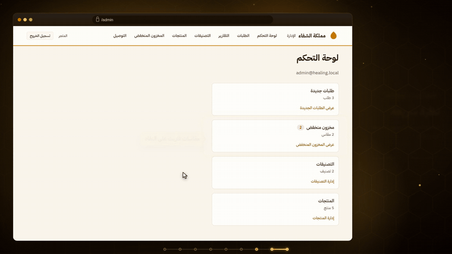
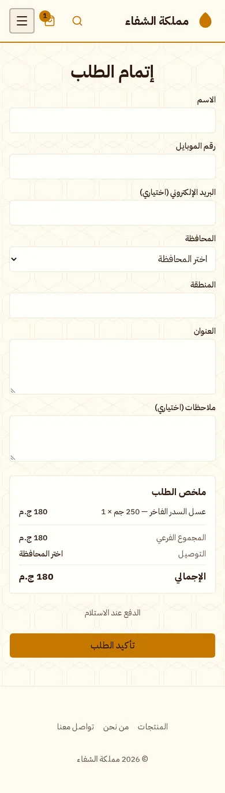
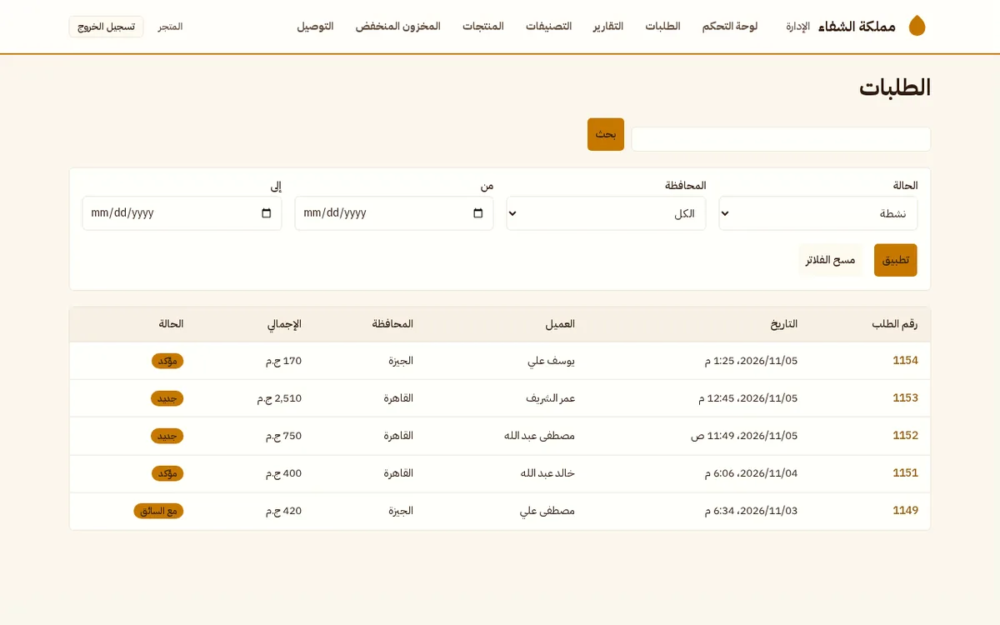
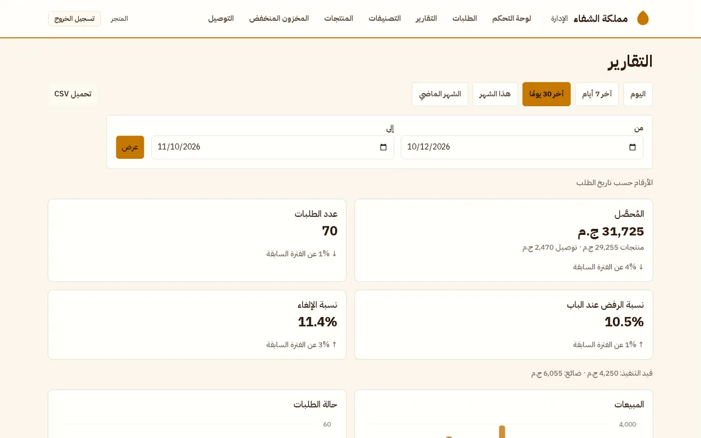

# Healing Kingdom: case study

An Arabic-only online honey store for an Egyptian client, with cash-on-delivery orders, the client's own delivery drivers, and a full admin dashboard.

> **The source code is private under the client agreement.** This repo shows what I built and how. A code walkthrough is available on request.

  

  

  Full demos: <a href="videos/storefront-demo.mp4">storefront (2:23)</a> · <a href="videos/admin-demo.mp4">admin dashboard (3:12)</a>

## The problem

The client sold honey through WhatsApp and Facebook messages. Orders, stock and delivery fees were tracked by hand, so mistakes and overselling were easy. The client wanted a real store that still felt familiar to Egyptian mobile shoppers, with no account sign-up, cash on delivery, and WhatsApp updates.

## What I built

**Storefront** (Arabic, right-to-left, mobile first)
- Catalogue with product variants (size and packaging), each with its own price and stock
- Arabic product search that matches different spellings of the same letters (أ/ا/إ, ة/ه, ى/ي)
- A one-page cash-on-delivery checkout with no sign-up; delivery fees are set per governorate (Cairo, Giza, Fayoum)
- Server-rendered pages with sitemap, Open Graph images and Product JSON-LD for SEO

**Admin dashboard**
- Products, variants, categories, images and low-stock alerts
- Order lifecycle `new → confirmed → preparing → out for delivery → delivered`, plus cancelled and refused, with a status history
- A one-tap "Notify on WhatsApp" button that sends the customer a ready-made Arabic message
- Sales reports by day, week or month: collected sales, refusal and cancellation rates, sales by governorate, top products, and CSV export

  
  
  

  

## Engineering decisions

- **No overselling.** The order and the stock deduction run in one database transaction. Stock drops only through a conditional update (`stock >= qty`), and the whole order rolls back if any line fails. Stock comes back exactly once when an order is cancelled or refused.
- **Money as integers.** Every price and total is stored as whole Egyptian pounds, never as a float.
- **A small MVP that doesn't block V1.** Anything that depended on outside parties, such as Meta's WhatsApp Business API approval, was kept out of the MVP. The schema is ready for it: customers are keyed by phone number, and notifications go through one function, so V1 can add OTP login and automatic WhatsApp messages without a rewrite.
- **Abuse protection on checkout.** Rate limits per phone number and per IP, a honeypot field, and quantity caps.
- **RTL from the start.** Only CSS logical properties are used, and a custom lint rule blocks physical ones (`ml-*`, `left-*`).

  

## How it was delivered

- **Spec-driven:** each feature went through spec → plan → tasks before any code was written (GitHub Spec Kit). There are 7 specs: foundation, catalogue, cart and checkout, orders and admin, SEO and packaging, search, and reports.
- **Tested:** 270+ automated tests, Vitest for unit and integration tests and Playwright for end-to-end tests on a mobile phone viewport.
- **CI:** GitHub Actions runs lint, typecheck, tests, the build, the end-to-end tests and the Docker image builds on every pull request.
- **Deploy-ready:** Docker Compose with PostgreSQL, Caddy for automatic HTTPS, and a backup job that sends database and image backups to S3-compatible storage. It runs on any Linux server.

## Stack

Next.js 16 · React 19 · TypeScript · Tailwind CSS v4 · shadcn/ui · PostgreSQL 16 · Prisma 7 · Better Auth · Zod · Vitest · Playwright · Docker · Caddy · GitHub Actions

---

Screenshots and videos use demo data with a placeholder store name and logo. No real client or customer data is shown.
Built by [Mostafa Abu-Hamed](https://github.com/MostafaAbuHamed). Open to freelance work: [LinkedIn](https://linkedin.com/in/mostafa-abuhamed).
